# 🧠 JARVIS OS Agent

> An open-source autonomous AI operating system for Windows. Controls your PC, Android phone, local files, and lifelong memory — with live mid-execution correction, dual-engine voice, and MCP-native tool integration.

[](https://www.python.org/)
[](https://www.microsoft.com/windows)
[](https://platform.openai.com)
[](https://modelcontextprotocol.io)
[](https://deepgram.com)
[](https://telegram.org)
[](https://hub.xerj.org/contributors/thekaifansari01)
[](https://jarvis-os-agent.vercel.app/documentation)
[](LICENSE)
[](https://github.com/thekaifansari01/Jarvis-OS-Agent/stargazers)

**[📖 Full Documentation →](https://jarvis-os-agent.vercel.app/documentation)** · **[🌐 Website](https://jarvis-os-agent.vercel.app/)** · **[🎮 Live Demo](https://snakegamebyjarvis.netlify.app/)**

---

## ⚡ Quick Install

Open PowerShell and run this single command. It auto-installs prerequisites, clones the repo, sets up the Python and Node environments, and registers the global `jarvis` CLI:

```powershell
Set-ExecutionPolicy Bypass -Scope Process -Force; [Net.ServicePointManager]::SecurityProtocol = [Net.SecurityProtocolType]::Tls12; & ([scriptblock]::Create((Invoke-RestMethod -Uri 'https://github.com/thekaifansari01/Jarvis-OS-Agent/releases/latest/download/install.ps1')))
```

Then launch:

```powershell
jarvis
```

Say **"Jarvis"** for voice, or press **`Ctrl+Shift+J`** for the keyboard command surface. Full setup walkthrough at [docs · Quick Start →](https://jarvis-os-agent.vercel.app/documentation?section=quick-start).

---

## ✨ What JARVIS Does

JARVIS is not a chat interface. It is an agent that takes actions on your actual system, remembers you across months, corrects itself mid-task, and reaches out proactively.

| | Feature | Description |
|:---:|:---|:---|
| 🔄 | **Live mid-execution correction** | Interrupt a multi-step task mid-run. Feedback is absorbed, the plan is revised in-place, and completed steps stay intact. No full restart. |
| ❓ | **Mid-task clarification (`ask_user`)** | When critical parameters are missing, the Agentic Brain pauses and summons a glassmorphic popup with the exact question. Your answer is pinned to confirmed facts and the loop resumes — no restart. |
| 🧠 | **Five-tier memory + hybrid RAG** | Rolling episodic history, weighted semantic graph (LTM), BM25 + vector RAG with RRF fusion, TTL ephemeral state, and semantic behavioral patterns — all on-device, zero API cost. |
| 🎙️ | **Dual-engine voice** | Azure Custom Keyword on-device wake word with a DSP conditioner and 5-gate acoustic verifier, Vosk fallback, Deepgram Nova-2 STT, and Sarvam TTS with word-level sync. |
| 🔌 | **MCP-native tool integration** | Plug into 18,000+ community servers via CLI or JSON. Live hot-reload within 2 seconds, zero restarts, native Windows `npx` resolution. |
| 📱 | **Real cross-device control** | Android via Termux WebSocket bridge, Telegram remote bot, Gmail, WhatsApp, Google Calendar, file system, terminal, and vision-based GUI automation. |
| 🎨 | **Four premium UIs** | Agent Panel (ZMQ thought stream + HITL gates), Typing Popup (markdown + TTS word sync), STT Popup (click-through voice waveform), Input Popup (dual-mode command + clarification). |
| ⚙️ | **Production-grade lifecycle** | 14-step graceful shutdown in ~2.6s, ServiceWatchdog auto-recovery, 3-tier router fallback, provider failover, and encrypted token storage. |

---

## 📸 Live UI

Real screenshots from the running system.

<table>
  <tr>
    <td align="center" width="50%">
      
      <br/>
      <sub><b>🖥️ Agent Panel</b> — Live thought stream + HITL consent · <a href="https://jarvis-os-agent.vercel.app/documentation?section=agent-panel">Deep dive →</a></sub>
    </td>
    <td align="center" width="50%">
      
      <br/>
      <sub><b>📝 Typing Popup</b> — Markdown response + async previews · <a href="https://jarvis-os-agent.vercel.app/documentation?section=typing-popup">Deep dive →</a></sub>
    </td>
  </tr>
  <tr>
    <td align="center" width="50%">
      
      <br/>
      <sub><b>🗣️ STT Popup</b> — Click-through voice input · <a href="https://jarvis-os-agent.vercel.app/documentation?section=stt-popup">Deep dive →</a></sub>
    </td>
    <td align="center" width="50%">
      
      <br/>
      <sub><b>⌨️ Input Popup</b> — Dual-mode command + clarification · <a href="https://jarvis-os-agent.vercel.app/documentation?section=input-popup">Deep dive →</a></sub>
    </td>
  </tr>
</table>

---

## 🏗️ Architecture

```mermaid
flowchart TD
    User["👤 Voice or Text Command"] --> Input{"Input Type"}
    Input -->|Voice| Wake["🎙️ Dual-Engine Wake Word<br/>Azure Custom Keyword + Vosk"]
    Input -->|Text| Hotkey["⌨️ Ctrl+Shift+J Popup"]
    Input -->|Remote| TelegramBot["🤖 Telegram Remote Bot"]
    Wake --> STT["⚡ Deepgram Nova-2 STT<br/>LTM Vocab + Phonetic Repair"]
    Hotkey --> Router["🚦 Hybrid Semantic Router"]
    TelegramBot -->|Silent Flag| Router
    STT --> Router
    Router -->|Fallback| LocalRouter["🔄 Local Rule-Based Router"]
    LocalRouter --> FastBrain

    Router -->|Simple / Stateless| FastBrain["⚡ FastBrain<br/>Fast LLM (OpenAI-compatible)"]
    Router -->|Complex / Stateful| AgenticBrain["🧠 AgenticBrain<br/>Primary + Fallback Providers"]

    AgenticBrain --> Providers["🔌 Provider Abstraction Layer"]
    Providers --> Primary["PrimaryProvider"]
    Providers --> Fallback["FallbackProvider"]

    subgraph Memory["🧠 Memory Ecosystem"]
        LTM[("🗄️ Vector Semantic Graph LTM<br/>Weighted + Decay")]
        ML[("🧬 Behavioral Pattern Engine<br/>Local Embeddings + JSONL")]
        RAG[("📚 Hybrid RAG<br/>BM25 + Vector + RRF")]
        Indexer["📊 Knowledge Indexer<br/>Flask :8080"]
        JSONL["📜 Rolling History<br/>2-Day Raw + 13-Day Summaries"]
        Ephemeral["⚡ Ephemeral State<br/>TTL + Device Cache + 90s HITL"]
    end

    Indexer -.->|Config| RAG
    AgenticBrain <--> Memory
    FastBrain <--> Memory

    subgraph Tools["🛠️ Native Tool Ecosystem"]
        Code["💻 Repo-Map / Replace-Block / AST"]
        Comms["📨 Gmail / WhatsApp / Telegram / Calendar"]
        System["⚙️ OS Control / Apps / Clipboard"]
        GUI["🖱️ GUI Automation (SOM / OpenCV)"]
        Search["🌐 Web / ArXiv / Scraper"]
        Vision["👁️ Multimodal Vision / OCR"]
        Image["🎨 Image Gen / Edit"]
        Mobile["📱 Mobile Bridge :8090"]
        PC["💻 PC Monitor"]
    end

    subgraph MCPLayer["🔌 MCP External Tools"]
        MCPManager["MCP Manager"]
        MCPBridge["Async Bridge"]
        MCPClients["stdio / HTTP / SSE"]
        MCPServers["External Servers<br/>GitHub · Brave · SQLite · Notion · Docker"]
        MCPManager --> MCPBridge --> MCPClients --> MCPServers
    end

    AgenticBrain --> Tools
    AgenticBrain -.-> MCPLayer
    FastBrain --> System
    FastBrain --> Search

    subgraph UI["🎨 UI Layer"]
        UnifiedPortal["🎛️ Unified Portal :8000"]
        AgentPanel["🖥️ Agent Panel (ZMQ)"]
        TypingPopup["📝 Typing Popup"]
        STTPopup["🗣️ STT Popup"]
        InputPopup["⌨️ Input Popup"]
    end

    AgenticBrain <-->|ZMQ PUB / PUSH-PULL| AgentPanel
    AgenticBrain <-->|ask_user| InputPopup
    FastBrain -->|typing_status.json| TypingPopup
    STT --> STTPopup
    InputPopup --> Router

    subgraph Proactive["🛡️ Proactive HITL Watchdog"]
        Listeners["📡 Email / WhatsApp / Telegram / PC Monitor"]
        Scout["🛡️ Proactive Scout Agent"]
        Consent["🔒 HITL Consent Gate"]
    end

    Listeners --> Scout --> AgenticBrain
    AgenticBrain --> Consent
    Consent --> AgenticBrain

    subgraph Resilience["⚙️ Resilience Layer"]
        Watchdog["🛡️ ServiceWatchdog"]
        Failover["🔄 Provider Failover"]
        Recovery["🔄 Two-Strike Rule"]
        LiveFix["🔴 Live Correction Feed"]
    end

    Watchdog -.-> System
    Failover -.-> Providers
    Recovery -.-> AgenticBrain
    LiveFix -.-> AgenticBrain
```



Deeper walkthrough: [docs · Architecture →](https://jarvis-os-agent.vercel.app/documentation?section=architecture)

---

## 🚀 Installation

### Prerequisites

| Requirement | Notes |
|---|---|
| **Windows 10 or 11** | Primary supported platform |
| **Python 3.10+** | Auto-installed by the 1-click installer |
| **Node.js 18+** | 24+ recommended for latest MCP servers |
| **~2 GB free disk** | Includes embedding model and dependencies |
| **One LLM API key** | Groq, OpenRouter, or OpenAI (free tiers available) |

### Manual Installation (Advanced)

```powershell
git clone https://github.com/thekaifansari01/Jarvis-OS-Agent.git
cd Jarvis-OS-Agent

python -m venv .venv
.\.venv\Scripts\Activate.ps1
python -m pip install --upgrade pip
pip install -r requirements.txt
pip install mcp

cd tools/Messanger/whatsapp/BaileysServer
npm install
cd ../../../..

python SetupRegistry.py
```

Then open a **new** terminal and run `jarvis`.

### Unified Portal

JARVIS ships a single FastAPI web app at `http://127.0.0.1:8000` that serves every web UI as a tab:

- **Knowledge Indexer** — RAG folder management, filters, pause/resume
- **Mobile Bridge** — Android pairing QR, device control, file transfer

Backends stay isolated on `:8080` (Indexer) and `:8090` (Mobile) with health checks and watchdog recovery.

---

## 📖 Documentation

Complete reference covers every subsystem with deep dives, code samples, and troubleshooting.

| | Section | Description |
|:---:|:---|:---|
| 🚀 | [Quick Start](https://jarvis-os-agent.vercel.app/documentation?section=quick-start) | Get running in 5 minutes |
| ⚙️ | [Environment](https://jarvis-os-agent.vercel.app/documentation?section=environment) | All `.env` variables and provider setup |
| 🎙️ | [Voice Setup](https://jarvis-os-agent.vercel.app/documentation?section=voice) | Azure wake word, Deepgram STT, Sarvam TTS |
| 🧠 | [Memory & RAG](https://jarvis-os-agent.vercel.app/documentation?section=memory) | Five-tier memory architecture |
| 🔌 | [MCP Integration](https://jarvis-os-agent.vercel.app/documentation?section=mcp) | Add external tool servers live |
| 📱 | [Android Bridge](https://jarvis-os-agent.vercel.app/documentation?section=android) | Termux + WebSocket setup |
| 🖥️ | [Agent Panel](https://jarvis-os-agent.vercel.app/documentation?section=agent-panel) | ZMQ thought stream + HITL deep dive |
| 🔄 | [Lifecycle & Shutdown](https://jarvis-os-agent.vercel.app/documentation?section=lifecycle-shutdown) | 14-step graceful shutdown |
| 🛠️ | [Tools Reference](https://jarvis-os-agent.vercel.app/documentation?section=tools) | Every native tool documented |
| ❓ | [Troubleshooting](https://jarvis-os-agent.vercel.app/documentation?section=troubleshooting) | Diagnostic decision tree |

---

## ⚙️ CLI Reference

Run memory, login, and reset commands with JARVIS **stopped**.

| Command | Action |
|---|---|
| `jarvis login --all` | Batch authenticate all integrations |
| `jarvis logout --all` | Revoke every session |
| `jarvis mcp list` | List MCP servers and live status |
| `jarvis mcp add <name> <cmd/url> [args] [-e K=V]` | Add or update an MCP server (hot-reloads live) |
| `jarvis mcp test <name>` | Test connection and list discovered tools |
| `jarvis bot --activate` | Configure Telegram remote bot (JARVIS off) |
| `jarvis bot --status` | Show live bot status |
| `jarvis memory --clear` | Purge contextual memory (keeps sessions) |
| `jarvis reset --hard` | Factory reset — wipes memory, vectors, sessions |
| `jarvis --help` | Global help |

Full CLI reference: [docs · CLI Commands →](https://jarvis-os-agent.vercel.app/documentation?section=cli)

---

## 🔌 MCP Integration

JARVIS supports the Model Context Protocol — Anthropic's open standard for connecting AI to external tools. Discovered tools appear in the Agentic Brain as `mcp__<server>__<tool>` and support live hot-reload with zero restarts.

```powershell
jarvis mcp add github npx @modelcontextprotocol/server-github -e GITHUB_PERSONAL_ACCESS_TOKEN=ghp_xxx
jarvis mcp add sqlite npx @modelcontextprotocol/server-sqlite C:/data/mydb.sqlite
jarvis mcp add remote_docs https://example.com/mcp/sse -H Authorization="Bearer xxx"
```

Or edit `Data/mcp_servers.json` directly — saved changes hot-reload within 2 seconds.

**Supported transports:** stdio (`command` + `args`), streamable HTTP (`url`), SSE (`url` + `transport: "sse"`).

**Popular servers:** GitHub, Brave Search, SQLite, Postgres, Notion, Slack, Docker, Puppeteer, Fetch.

MCP is **opt-in**. If `Data/mcp_servers.json` is missing or empty, JARVIS boots with zero overhead.

Full MCP setup: [docs · MCP Servers →](https://jarvis-os-agent.vercel.app/documentation?section=mcp)

---

## 🤝 Contributing

Contributions are welcome — bug fixes, new providers, documentation, and tool integrations.

1. Fork the repository
2. Create a branch (`git checkout -b feature/MyFeature`)
3. Commit (`git commit -m 'Add MyFeature'`)
4. Push (`git push origin feature/MyFeature`)
5. Open a Pull Request

Read [CONTRIBUTING.md](CONTRIBUTING.md) for the Contributor License Agreement and [CODE_OF_CONDUCT.md](CODE_OF_CONDUCT.md) before contributing.

Look for the [`good first issue`](https://github.com/thekaifansari01/Jarvis-OS-Agent/labels/good%20first%20issue) label to get started.

---

## 📄 License

Distributed under the **GNU General Public License v3.0**. See [LICENSE](LICENSE) for the full text.

---

## 👤 Author

Built and maintained by **Kaif Ansari** ([@thekaifansari01](https://github.com/thekaifansari01)) — a self-taught developer pursuing a BCA. JARVIS is his open-source contribution to the autonomous agent space: a fully local, model-agnostic framework for building personal AI operating systems.

**Connect:** [Twitter / X](https://twitter.com/thekaifansari01) · [GitHub](https://github.com/thekaifansari01) · [LinkedIn](https://linkedin.com/in/thekaifansari01) · [Instagram](https://instagram.com/thekaifansari01) · [Reddit](https://reddit.com/user/thekaifansari01) · [Discord](https://discord.com/users/thekaifansari01) · [Email](mailto:thekaifansari01@gmail.com)

---

## 🌟 Support

If JARVIS helped you automate something real, star the repo — it helps more developers discover the project.

[](https://star-history.com/#thekaifansari01/Jarvis-OS-Agent&Date)

---

<p align="center">
  <i>"Any sufficiently advanced technology is indistinguishable from magic." — Arthur C. Clarke</i>
</p>