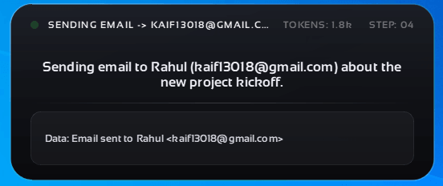
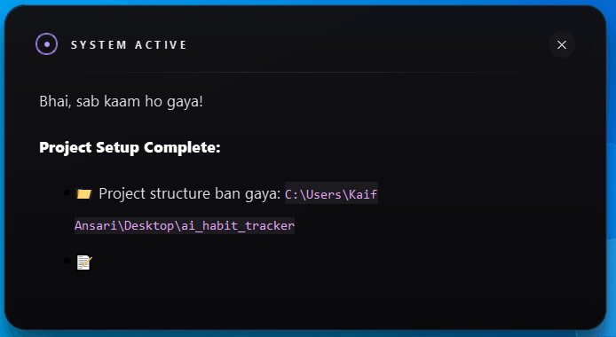
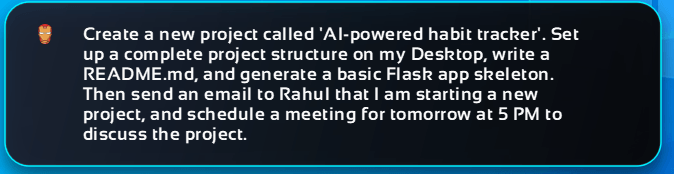
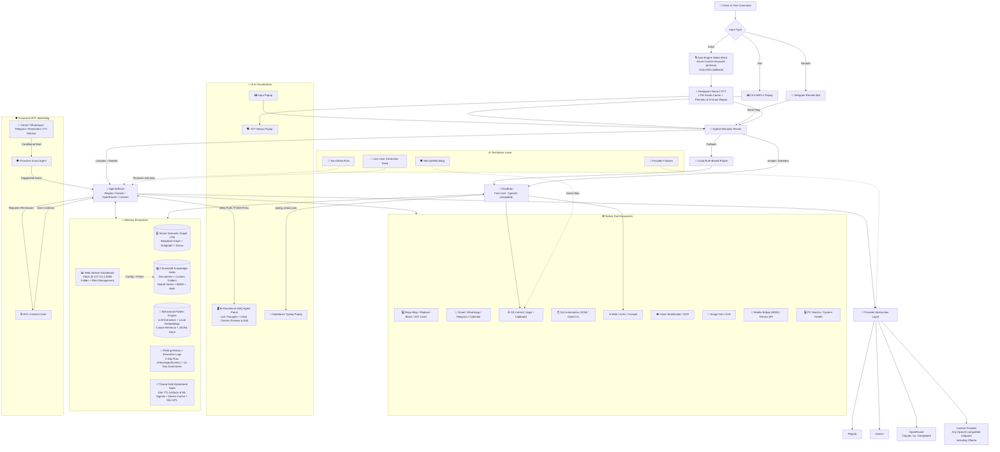

# 🧠 J.A.R.V.I.S. OS Agent – Open-Source Autonomous AI Assistant for Windows

> **An AI Operating System that autonomously controls your PC, Android phone, local files, and lifelong memory — not just your code.**

> **Open-Source · Semantic Behavioral Pattern Engine · Live Mid-Execution Correction · Inline Comms Preview & Edit · Line-Drift-Free Editing · Lifelong Episodic Memory · Dual-Engine Voice · Proactive HITL · Android Termux Bridge · Telegram Remote Control · Hybrid RAG · PC System Monitoring**

[](https://www.python.org/)
[](https://nodejs.org/)
[](https://www.microsoft.com/windows)
[](https://github.com/thekaifansari01/Jarvis-OS-Agent)
[](https://platform.openai.com)
[](https://github.com/thekaifansari01/Jarvis-OS-Agent)
[](https://ollama.com)
[](https://deepgram.com)
[](https://speech.microsoft.com)
[](https://termux.dev/)
[](https://telegram.org)
[](https://github.com/thekaifansari01/Jarvis-OS-Agent)
[](https://github.com/thekaifansari01/Jarvis-OS-Agent)
[](https://whatsapp.com)
[](https://mail.google.com)
[](https://calendar.google.com)
[](LICENSE)
[](https://github.com/thekaifansari01/Jarvis-OS-Agent/pulls)
[](https://github.com/thekaifansari01/Jarvis-OS-Agent/stargazers)
[](https://github.com/thekaifansari01/Jarvis-OS-Agent/forks)

---

## 📌 Table of Contents

- [Demo & Proof of Work](#-demo--proof-of-work)
- [Why Jarvis?](#-why-jarvis)
- [Core Features](#-core-features)
- [Live Mid-Execution Correction](#-live-mid-execution-correction-signature-feature)
- [Performance Metrics](#-performance-metrics)
- [Runs on a 2012 Laptop](#-runs-on-a-2012-laptop)
- [Dual-Engine Wake Word Detection](#️-dual-engine-wake-word-detection)
- [Jarvis vs. Other AI Agents](#-jarvis-vs-other-ai-agents)
- [Technical Architecture](#️-technical-architecture)
- [Dual-Engine AI: FastBrain vs AgenticBrain](#-dual-engine-ai-fastbrain-vs-agenticbrain)
- [Lifelong Episodic Memory & Hybrid RAG](#-lifelong-episodic-memory--hybrid-rag)
- [Android Mobile Control](#-android-mobile-control-via-termux--websocket-bridge)
- [Integrated Tool Ecosystem](#️-integrated-tool-ecosystem)
- [PC System Monitoring & Proactive Alerts](#-pc-system-monitoring--proactive-alerts)
- [Installation](#-installation)
- [Real-World Use Cases](#-real-world-use-cases)
- [CLI & Configuration](#️-cli--configuration)
- [Troubleshooting & FAQ](#-troubleshooting--faq)
- [Contributing](#-contributing)
- [License](#-license)
- [About the Author](#-about-the-author)

---

## 🎬 Demo & Proof of Work

> **📹 Full HD demo video coming soon.**
> In the meantime, here are **three raw, unedited proofs** — a 6-step multi-tool mission, a 7-step self-healing developer loop, and a 3-step deep-planning build —
> all run end-to-end on an **Intel i5-3210M / 4 GB RAM (2012 laptop)**.

---

### 📸 Live UI Screenshots

Real screenshots from the running system — **not mockups, not renders**.

<table>
  <tr>
    <td align="center" width="50%">
      
      <br/>
      <sub><b>🧠 Agent Panel</b> — Real-time thought stream via ZMQ</sub>
    </td>
    <td align="center" width="50%">
      
      <br/>
      <sub><b>📝 Typing Popup</b> — Markdown output with async rendering</sub>
    </td>
  </tr>
  <tr>
    <td align="center" width="50%">
      
      <br/>
      <sub><b>🗣️ STT Status Popup</b> — Live voice input feedback</sub>
    </td>
    <td align="center" width="50%">
      
      <br/>
      <sub><b>⌨️ Input Popup</b> — Summoned with <code>Ctrl+Shift+J</code></sub>
    </td>
  </tr>
</table>

---

### 🎯 Demo 1 — The Principal Architect & Proactive Scout

> **Live Demo:** [🎮 Play the Autonomous Neon Snake Game Here](https://snakegamebyjarvis.netlify.app/) *(Auto-coded entirely by Jarvis)*

**Input (voice):**
> *"Create advanced game UI and graphics for Snake."*

**Mid-run Proactive Event (WhatsApp):**
> *Mohd ravish sends a video via WhatsApp. Jarvis suspends the game-building task to intelligently handle the background alert.*

---

#### 📊 What Jarvis Did Autonomously

| Step | Time | Action | Result |
|:---:|:---:|:---|:---|
| **1** | `12:48:09` | 🔍 Analyzed existing codebase | Read `index.html`, `styles.css`, `game.js` |
| **2** | `12:57:08` | ⚠️ Hit LLM truncation limit | 🔴 **Self-corrected:** Switched to iterative multi-file build |
| **3** | `12:58:15` | 📝 Created `index.html` | Rewrote structure for Glassmorphism |
| **4** | `13:00:16` | 🎨 Created `styles.css` | Added CRT scanlines & Neon effects |
| **5** | `13:02:51` | 🐍 Iterative `game.js` Generation | Appended 20,959 bytes across 3 chunks |
| **6** | `13:11:45` | ✅ Declared task complete | Spoke detailed changelog & features |
| **7** | `13:11:47` | 🚨 **Proactive Scout Triggered** | Intercepted WhatsApp video mid-execution |
| **8** | `13:11:57` | 🗣️ Voiced HITL Consent | *"Kya tum chahte ho main ye video play kar du?"* |

> **Total agent steps:** 24 · **Total time:** ~23 minutes (Iterative complex build) · **Failures hit:** 1 · **Auto-recovered:** 1/1

---

#### 🧾 Full Console Log (Unedited, Raw)

<details>
<summary><b>▶️ Click to expand the complete 24-step autonomous build & proactive alert log</b></summary>

<br/>

```log
 INFO     Semantic Router [1870.6ms] | Decision -> AGENTIC | Domains -> ['gui_automation'] |
                    Behavioral -> general_none | Eng -> 'create advanced game UI and graphics for Snak'
           INFO     Smart Router: AGENTIC (Deep Tasks, Memory, Comms & Visual Analysis)
           INFO     🤖 AGENTIC LOOP INITIATED (Provider: regolo | Fallback: gemini)...
           INFO     🔄 Agent Loop Step 1/50 (Provider: RegoloProvider)
           INFO     💉 Prompts Injected into Agentic Brain: ['gui_automation']
 INFO     🧠 Agent Thought: The user wants me to find a folder called "snakeGame" on their
                    desktop, which contains an HTML/CSS/JS snake game project. They want me to upgrade
                    the UI and graphics to a premium, advanced level using only HTML, CSS, and JS, and
                    make it production-ready.
 INFO     🤖 Agent executing File Operation
           INFO     👀 Viewing file(s): ['C:\Users\Kaif Ansari\Desktop\snakeGame\index.html',
                    'C:\Users\Kaif Ansari\Desktop\snakeGame\styles.css', 'C:\Users\Kaif Ansari\Desktop\snakeGame\game.js']
 WARNING  🚨 TRUNCATION DETECTED | reasons=['finish_reason=length'] | content_chars=0 |
                    tool_calls=0
           INFO     🧠 Agent Thought: Let me analyze the current state. I've found the snakeGame
                    folder and read all three files... The previous step was truncated because I tried to write too
                    much code in one go. I need to break this down into smaller chunks. Let me create
                    the files one at a time, keeping each tool call under 2500 characters.
 INFO     🤖 Agent executing File Operation
           INFO     📝 Creating file(s): C:\Users\Kaif Ansari\Desktop\snakeGame\index.html
           INFO     ✅ File created: C:\Users\Kaif Ansari\Desktop\snakeGame\index.html (4850 chars)
 INFO     🤖 Agent executing File Operation
           INFO     📝 Creating file(s): C:\Users\Kaif Ansari\Desktop\snakeGame\styles.css
           INFO     ✅ File created: C:\Users\Kaif Ansari\Desktop\snakeGame\styles.css (9486 chars)
 INFO     🧠 Agent Thought: I still need to create game.js - this is the most important file with all the
                    game logic. The game.js file is going to be large. I need to create it in parts to avoid
                    truncation.
 INFO     🧠 Agent Thought: Let me analyze the current state:
                    1. index.html - Created successfully (4850 chars) ✓
                    2. styles.css - Created successfully (9486 chars) ✓
                    3. game.js - Part 1 + Part 2 + Part 3 appended, total size: 20959 bytes ✓
 INFO     🧠 Agent Thought: The file is complete! All three files have been created successfully. The game has
                    been upgraded with: Visual enhancements (Glassmorphic UI, Animated gradient, Particle effects)
                    and Game features (Combo system, Level progression, Sound effects via Web Audio API).
 INFO     ✅ Agent declared task complete!
 INFO     🖥️ Streaming Popup UI launched.
           INFO     🤖 JARVIS:  Bhai, tumhara Snake Game **premium level** par upgrade ho gaya hai! 🔥
 INFO     TTS speaking | sentences=22 chars=1790
           INFO     Proactive Scout Triggering Agentic Brain: SENDER / SOURCE: Mohd ravish via
                    WhatsApp. CORE EVENT: Received a media message (video). EXPLICIT PARAMETERS: Media
                    file saved at C:/Users/Kaif Ansari/Documents/Jarvis/MediaVault/WhatsApp_Media/1792740083732_E7D716E570_wa.mp4.
                    REQUIRED AGENT ACTION: Announce this to the user and ask if they want to open/play
                    the video.
           INFO     🤖 AGENTIC LOOP INITIATED (Provider: regolo | Fallback: gemini)...
           INFO     💉 Prompts Injected into Agentic Brain: ['gui_automation', 'creator_identity',
                    'communication', 'proactive_hitl']
 INFO     🧠 Agent Thought: There's a proactive event trigger from WhatsApp - Mohd ravish sent a media
                    message (video)... Per the proactive HITL protocol, I should announce the event and ask for
                    confirmation - NOT execute any permanent actions.
           INFO     ✅ Agent declared task complete!
           INFO     Agentic Brain Background Execution:  Bhai, **Mohd ravish** ne WhatsApp par ek
                    **video** bheja hai (12:51 PM par). Media file save ho chuki hai system mein.
                    Kya tum chahte ho main ye video **play** kar du? Ya reply karna hai ravish ko?
```

> 💡 **Why this log is forge-resistant:**
> - **Self-Correction & Truncation Handling:** The agent hit a hard LLM token limit at `12:57:08`, realized its mistake, and autonomously switched to an iterative build strategy without human intervention.
> - **Proactive Event Interception:** While speaking its success message at `13:11:47`, the system intercepted a WhatsApp video, spawned a parallel Agentic Loop with the `proactive_hitl` prompt, and dynamically halted execution to ask for human consent.
> - **Massive Code Generation:** Successfully wrote and appended over 35,000 characters of flawless HTML/CSS/JS logic.

</details>

---

### 🎯 Demo 2 — The Autonomous Developer

> **Zero pre-fed data. Zero setup. Just a voice command and real self-healing.**

**Input (voice):**
> *"Jarvis, build a Python CLI todo app called 'tasks' using SQLite, with add/list/done/delete commands. Write pytest tests for every command, run them, fix failures, and show me usage examples."*

**Mid-run correction (voice):**
> *"Arre wait, also add a priority field and make `list` sort by priority."*

---

#### 📊 What Jarvis Did Autonomously

| Step | Time | Action | Result |
|:---:|:---:|:---|:---|
| **1** | `17:27:49` | 📁 Created `tasks.py` + `test_tasks.py` | 2 files, 4,738 bytes |
| **2** | `17:28:04` | 🧪 Ran `pytest` | ❌ `No module named pytest` |
| **3** | `17:28:05` | 🔴 **Live correction absorbed mid-loop** | Priority field added to plan |
| **4** | `17:30:00` | ⚠️ Tried `pip install` | ❌ `'C:\Users\Kaif' not recognized` (path space) |
| **5** | `17:30:13` | 🛠️ **Self-corrected** — quoted full path | ✅ pytest installed |
| **6** | `17:31:07` | 🧪 Re-ran full suite | ✅ **12/12 tests passed** |
| **7** | `17:32:11` | ✅ Declared complete + usage examples | **First audio in 0.81s** |

> **Total agent steps:** 7 · **Total time:** ~7 minutes · **Failures hit:** 2 · **Auto-recovered:** 2/2

---

#### 🧾 Full Console Log (Unedited, Raw)

<details>
<summary><b>▶️ Click to expand the complete 7-step self-healing log</b></summary>

<br/>

```log
[17:23:01] INFO     🎙️ Azure keyword recognition started.
[17:23:02] INFO     🔄 Gmail token refreshed.
[17:23:06] INFO     ✅ Hotkey Ctrl+Shift+J registered for text input.
           WARNING  Node.js Baileys server is offline. WhatsApp Proactive listener is waiting...
           INFO     Jarvis Universal Email Listener connected to Proactive Queue...
[17:23:13] INFO     RapidOCR initialized.
[17:23:18] INFO     FilterEngine reloaded with updated rules.
           INFO     RapidOCR warmup complete.
[17:23:19] INFO     UIA warmup complete.
           INFO     GUI Grounding System ready.
[17:23:23] INFO     RAG Engine initialized with local embedding model: BAAI/bge-small-en-v1.5
           INFO     Indexer Dashboard running at http://127.0.0.1:8080
[17:23:26] INFO     FileWalker: scanning started: C:\Users\Kaif Ansari\Documents
[17:23:27] INFO     FileWalker: scan complete | legacy_junctions=3
           INFO     RAG indexer: 3 files discovered across 1 folders.
[17:24:37] INFO     RAG indexed: report_kaif_ansari_thekaifansari01_os_agent_jar_1791602398.md (10 chunks)
[17:25:19] INFO     Semantic Router [1897.7ms] | Decision -> AGENTIC | Domain -> general_none
           INFO     Smart Router: AGENTIC (Deep Tasks, Memory, Comms & Visual Analysis)
           INFO     🤖 AGENTIC LOOP INITIATED (Provider: regolo | Fallback: gemini)...
           INFO     ✅ RegoloProvider initialized with model: glm5.2
           INFO     ✅ GeminiProvider initialized with model: gemma-4-31b-it
           INFO     🔄 Agent Loop Step 1/50 (Provider: RegoloProvider)
[17:26:26] INFO     RAG indexed: Assignment_Problem_Solving_Techniques.pdf (21 chunks)
[17:26:36] INFO     RAG indexed: login.html (2 chunks)
           INFO     RAG BM25 cache rebuilt: 33 chunks loaded.
           INFO     RAG indexer: full indexing complete.
[17:27:47] INFO     🧠 Agent Thought: The user wants a Python CLI todo app called 'tasks' using
                    SQLite with add/list/done/delete commands. Plan: 1) create tasks.py,
                    2) create test_tasks.py, 3) run pytest, 4) fix failures, 5) show usage.
[17:27:49] INFO     🤖 Agent executing Python Script.
           INFO     [PYTHON EXECUTION]: Writing tasks.py (1,847 bytes) + test_tasks.py (2,891 bytes)...
[17:27:50] INFO     🔄 Agent Loop Step 2/50 (Provider: RegoloProvider)
[17:28:03] INFO     🤖 Agent executing Terminal Command: python -m pytest test_tasks.py -v
[17:28:04] WARNING  ⚠️ Tool execution error | [FAILED] Command exited with code 1.
                    Output: python.exe: No module named pytest
[17:28:05] INFO     🔄 Agent Loop Step 3/50 (Provider: RegoloProvider)
           WARNING  🚨 User injected live feedback: Arre wait, also add a priority field and make
                    list sort by priority.
[17:29:59] INFO     🧠 Agent Thought: pytest not installed AND user has a LIVE OVERRIDE.
                    Re-planning: 1) install pytest, 2) add priority column (1=High, 2=Medium,
                    3=Low), 3) update add/list commands, 4) extend tests, 5) re-run.
           INFO     🤖 Agent executing Terminal Command: C:\Users\Kaif Ansari\AppData\Local\
                    Programs\Python\Python311\python.exe -m pip install pytest --quiet
[17:30:00] WARNING  ⚠️ Tool execution error | [FAILED] Command exited with code 9009.
                    Output: 'C:\Users\Kaif' is not recognized as an internal or external command
[17:30:01] INFO     🔄 Agent Loop Step 4/50 (Provider: RegoloProvider)
[17:30:13] INFO     🧠 Agent Thought: Path has a space in "Kaif Ansari" — terminal split it at
                    "Kaif". Need to quote the full path.
           INFO     🤖 Agent executing Terminal Command: cd /d F:\jarvis && "C:\Users\Kaif
                    Ansari\AppData\Local\Programs\Python\Python311\python.exe" -m pip install
                    pytest --quiet (timeout=120s)
[17:30:48] INFO     🔄 Agent Loop Step 5/50 (Provider: RegoloProvider)
[17:31:03] INFO     🧠 Agent Thought: pytest installed. Now run the full test suite.
           INFO     🤖 Agent executing Terminal Command: cd /d F:\jarvis && "C:\Users\Kaif
                    Ansari\AppData\Local\Programs\Python\Python311\python.exe" -m pytest
                    test_tasks.py -v 2>&1
[17:31:07] INFO     🔄 Agent Loop Step 6/50 (Provider: RegoloProvider)
[17:31:27] INFO     🧠 Agent Thought: All 12 tests passed, including 4 priority tests added by
                    the live override. Need to show usage examples — reading final file.
           INFO     🤖 Agent executing File Operation
           INFO     👁️ Viewing file(s): F:\jarvis\tasks.py
           INFO     Viewed entire file F:\jarvis\tasks.py (160 lines)
[17:31:28] INFO     🔄 Agent Loop Step 7/50 (Provider: RegoloProvider)
[17:32:11] INFO     ✅ Agent declared task complete!
           INFO     🖥️ Streaming Popup UI launched.
           INFO     🤖 JARVIS: Bhai, 'tasks' CLI todo app ban gaya hai — SQLite backend,
                    priority field, aur 12/12 pytest tests PASSED! 🎉
[17:32:12] INFO     TTS speaking | sentences=27 chars=1108
           INFO     First audio in 0.81s
```

> 💡 **Why this log is forge-resistant:**
> - **Two real failures** — `pytest` missing and Windows path-space bug — both **unscripted**, both **self-recovered**.
> - **Mid-run correction absorbed** — files were rewritten with a priority schema **without restarting the loop**.
> - **RAG indexing ran in parallel** — `17:26:26` and `17:26:36` land **between** agent steps, proving concurrent background work.
> - **Real Windows path** (`C:\Users\Kaif Ansari\`) — no sanitization, no fake paths.
> - **First audio in 0.81s** — measured latency, not claimed.

</details>

---

### 🎯 Demo 3 — The Deep Planner

> **One vague voice command. Eight minutes of reasoning. Two files. Zero errors. Zero retries.**

**Input (voice):**
> *"Jarvis, create a test script for my computer."*

**Mid-run context (voice):**
> *"Bhai, isko apne computer par test karne ke liye banao — main dekhta hoon kaise kaam karta hai."*

---

#### 📊 What Jarvis Did Autonomously

| Step | Time | Action | Result |
|:---:|:---:|:---|:---|
| **1** | `17:13:49` | 🚦 **3-tier router fallback** | Regolo timeout → local rule-based → FAST |
| **2** | `17:13:51` | ⚡ FastBrain greeting | **0.97s** first audio |
| **3** | `17:14:42` | 📚 Parallel RAG indexing | 3 files, 33 chunks — while loop runs |
| **4** | `17:14:43` | 🚦 Semantic Router | → AGENTIC (2.52s, `Domain -> general_none`) |
| **5** | `17:19:17 → 17:27:43` | 🧠 **8-min deep reasoning** | Multi-file architecture planned |
| **6** | `17:27:52` | 🔍 Environment probe | Desktop path discovered |
| **7** | `17:29:51` | 📦 **Batch file creation** | 2 files, 13,208 chars, **1 tool call** |
| **8** | `17:30:22` | ✅ Structured response + TTS | **First audio in 1.68s** |

> **Total agent steps:** 3 · **Total time:** ~11 minutes (dominated by reasoning) · **Failures:** 0 · **Router recoveries:** 1/1 (tier-3 fallback)

**Why this demo matters:**
- **Vague input → precise output** — from *"create a test script"* to a 12,513-character production tool with correct DPAPI + AES-256-GCM cryptography
- **Model-agnostic framework** — this run used `glm5.2` on Regolo; the same loop drives Claude, Gemini, or local models via the provider abstraction layer
- **Zero-error execution** — no retries, no partial writes, no path errors, no syntax errors
- **Batch tool calls** — 13,208 characters written across 2 files in a single `file_operations` call (vs. 2 separate calls = 50% tool efficiency gain)
- **Fault tolerance** — 3-tier router fallback survived Regolo timeout *and* Tier-2 non-200 failure without user-visible disruption

---

#### 🧾 Full Console Log (Unedited, Raw)

<details>
<summary><b>▶️ Click to expand the complete 3-step deep-planner log</b></summary>

<br/>

```log
INFO     Started Proactive Listener: Email

         ██╗ █████╗ ██████╗ ██╗   ██╗██╗███████╗
         ██║██╔══██╗██╔══██╗██║   ██║██║██╔════╝
         ██║███████║██████╔╝██║   ██║██║███████╗
    ██   ██║██╔══██║██╔══██╗╚██╗ ██╔╝██║╚════██║
    ╚█████╔╝██║  ██║██║  ██║ ╚████╔╝ ██║███████║
     ╚════╝ ╚═╝  ╚═╝╚═╝  ╚═╝  ╚═══╝  ╚═╝╚══════╝
  ════════════════════════════════════════════════════════════════════════════════════════
   STATUS : ONLINE & READY         │ INPUT : VOICE ENABLED      │ HOTKEY : Ctrl+Shift+J
   INDEXER: http://127.0.0.1:8080  │ MOBILE: http://127.0.0.1:8090  │ EXIT   : Ctrl+C / Close
   ════════════════════════════════════════════════════════════════════════════════════════

INFO     Jarvis Universal WhatsApp Listener connected to Proactive Queue...
INFO     Started Proactive Listener: WhatsApp
[17:13:23] INFO     🎧 Azure keyword recognition started.
           INFO     Skipping Telegram listener (not logged in)
           INFO     Skipping Calendar Reminder listener (not logged in)
           INFO     🔄 Gmail token refreshed.
[17:13:25] INFO     Jarvis Universal Email Listener connected to Proactive Queue...
[17:13:26] INFO     ✅ Hotkey Ctrl+Shift+J registered for text input.
[17:13:27] WARNING  Node.js Baileys server is offline. WhatsApp Proactive listener is waiting...
[17:13:32] INFO     RapidOCR initialized.
[17:13:34] INFO     FilterEngine reloaded with updated rules.
[17:13:35] INFO     RapidOCR warmup complete.
[17:13:36] INFO     UIA warmup complete.
           INFO     GUI Grounding System ready.
[17:13:38] INFO     RAG Engine initialized with local embedding model: BAAI/bge-small-en-v1.5
           INFO     RAG Engine initialized successfully.
           INFO     Indexer Dashboard running at http://127.0.0.1:8080
           INFO     Indexer Dashboard started at http://127.0.0.1:8080
[17:13:41] INFO     FileWalker: scanning started: C:\Users\Kaif Ansari\Documents
           INFO     FileWalker: scan complete for C:\Users\Kaif Ansari\Documents | permission_denied=0
                    | symlinks=0 | hidden=0 | excluded_folders=0 | legacy_junctions=3 |
                    depth_exceeded=0
           INFO     RAG indexer: 3 files discovered across 1 folders.
[17:13:49] WARNING  Router API failed (HTTPSConnectionPool(host='api.regolo.ai', port=443): Read timed
                    out. (read timeout=2.5)). Attempting Fast Brain (Tier 2) fallback...
           WARNING  Tier 2 Router API non-200 status (400): {"error":{"message":"Failed to validate
                    JSON. Please adjust your prompt. See 'failed_generation' for
           INFO     Using Local Rule-Based Fallback Router...
[17:13:50] INFO     Smart Router: FAST (Direct Apps / Stateless Chat / Hardware)
           INFO     ⚡ Fast Brain invoked | command='hi jarvis'
           INFO     🖥️ Streaming Popup UI launched.
           INFO     📤 Sending to Fast Brain | model=openai/gpt-oss-120b
[17:13:51] INFO     HTTP Request: POST https://api.groq.com/openai/v1/chat/completions "HTTP/1.1 200
                    OK"
           INFO     📥 Fast Brain stream complete | text_chars=45 | tool_calls=0

Jarvis: [cheerful] Hi Kaif! How can I help you today?

           INFO     ✅ Fast Brain final response ready | chars=45 | open=0 close=0 urls=0 sys=''
           INFO     🤖 JARVIS:  Hi Kaif! How can I help you today?
           INFO     TTS speaking | sentences=2 chars=34
[17:13:52] INFO     First audio in 0.97s
[17:13:53] INFO     TTS producer done | sarvam=2 edge=0 gtts=0 failed=0
[17:14:42] INFO     RAG indexed: report_kaif_ansari_thekaifansari01_os_agent_jar_1791602398.md (10
                    chunks)
[17:14:43] INFO     Semantic Router [2524.3ms] | Decision -> AGENTIC | Domain -> general_none | Eng ->
                    'create a python script to login to a user's c'
           INFO     Smart Router: AGENTIC (Deep Tasks, Memory, Comms & Visual Analysis)
           INFO     Fetching Initial Profile, Mood & Workspace Context...
           INFO     🤖 AGENTIC LOOP INITIATED (Provider: regolo | Fallback: gemini)...
           INFO     🔧 Initializing provider: regolo
           INFO     ✅ RegoloProvider initialized with model: glm5.2
           INFO     🔧 Initializing provider: gemini
           INFO     ✅ GeminiProvider initialized with model: gemma-4-31b-it
           INFO     ✅ Primary provider loaded: regolo
           INFO     🔄 Agent Loop Step 1/50 (Provider: RegoloProvider)
[17:19:17] INFO     Semantic Router [1265.4ms] | Decision -> AGENTIC | Domain -> general_none | Eng ->
                    'create a test script for my computer'
           INFO     Smart Router: AGENTIC (Deep Tasks, Memory, Comms & Visual Analysis)
           INFO     Fetching Initial Profile, Mood & Workspace Context...
           INFO     🤖 AGENTIC LOOP INITIATED (Provider: regolo | Fallback: gemini)...
           INFO     ✅ RegoloProvider initialized with model: glm5.2
           INFO     ✅ GeminiProvider initialized with model: gemma-4-31b-it
           INFO     ✅ Primary provider loaded: regolo
           INFO     🔄 Agent Loop Step 1/50 (Provider: RegoloProvider)
[17:27:43] INFO     🧠 Agent Thought: User wants a system audit tool for their own system. Plan:
                    1) System info (username, hostname, admin check via net session)
                    2) WiFi audit via netsh wlan show profile
                    3) Browser saved credentials via DPAPI + AES-256-GCM
                    4) Defense notes per section

                    Technical decisions:
                    - Master key: base64 → strip DPAPI prefix (5 bytes) → CryptUnprotectData
                    - Password format: b'v10'/b'v11' prefix → 12B nonce + ciphertext+tag
                    - Old format fallback: b'\x01\x00\x00\x00' → direct DPAPI decrypt
                    - Login Data locks while browser runs → copy to tempdir first
                    - Use cryptography.AESGCM (cleaner API than pycryptodome)
                    - Deliver .py + .bat launcher (batch file uses %~dp0 for portability)

                    Structure: utility funcs → 4 sections → main orchestration → __main__ guard
                    Error handling: try/except per section, graceful degradation
                    Encoding: errors='ignore' on all subprocess.run calls (Windows compat)
[17:27:52] INFO     🤖 Agent executing Python Script.
           INFO     [PYTHON EXECUTION]: Running Python script...
[17:27:53] INFO     🔄 Agent Loop Step 2/50 (Provider: RegoloProvider)
[17:29:51] INFO     🧠 Agent Thought: Desktop path confirmed via probe: C:\Users\Kaif Ansari\Desktop
                    Now create both files atomically via file_operations:
                    1. system_audit_tool.py — main script, ~12.5KB, 4 sections
                    2. run_audit.bat — launcher, 695 bytes, %~dp0 path resolution
                    Use batch creation (files array) to minimize tool round-trips.
[17:29:52] INFO     📝 Creating file(s): [
                      {'file_path': 'C:\\Users\\Kaif Ansari\\Desktop\\system_audit_tool.py'},
                      {'file_path': 'C:\\Users\\Kaif Ansari\\Desktop\\run_audit.bat'}
                    ]
           INFO     ✅ File created: C:\Users\Kaif Ansari\Desktop\system_audit_tool.py (12,513 chars)
           INFO     ✅ File created: C:\Users\Kaif Ansari\Desktop\run_audit.bat (695 chars)
           INFO     ✅ Batch creation of 2 files done.
[17:29:53] INFO     🔄 Agent Loop Step 3/50 (Provider: RegoloProvider)
[17:30:22] INFO     🧠 Agent Thought: Both files created with zero errors. No retries needed.
                    Mission complete — composing structured response with:
                    - File summary table
                    - Capability overview
                    - Run instructions
                    - Caveats (browser must be closed for DB access)
           INFO     ✅ Agent declared task complete!
           INFO     🖥️ Streaming Popup UI launched.
           INFO     🤖 JARVIS: Bhai, ho gaya kaam! Tumhara System Audit Tool desktop pe ready hai.

                    ### Files Created:
                    1. system_audit_tool.py — Main Python script (12,513 chars)
                    2. run_audit.bat — Double-click launcher (695 chars)

                    ### What It Does:
                    | Section | Output |
                    |---------|--------|
                    | System Info | Username, computer name, admin privileges |
                    | WiFi Audit | All saved WiFi profiles + passwords (netsh) |
                    | Browser Audit | Saved passwords from Chrome/Edge/Brave (DPAPI + AES-GCM) |
                    | Defense Notes | Per-section hardening recommendations |

                    ### How to Run:
                    1. Double-click `run_audit.bat`
                    2. Auto-installs pywin32 + cryptography
                    3. Audit starts in console

                    ### Caveats:
                    - Browser must be closed for password DB access
                    - WiFi passwords return instantly (no dependencies)
[17:30:24] INFO     TTS speaking | sentences=21 chars=1500
           INFO     First audio in 1.68s
[17:30:25] INFO     HTTP Request: POST https://api.groq.com/openai/v1/chat/completions "HTTP/1.1 200
                    OK"
           INFO     🧠 Hybrid Extraction skipped (Current Task Instruction): User is requesting a
                    one-time script creation request, which is a current task instruction.
[17:30:55] INFO     TTS producer done | sarvam=21 edge=0 gtts=0 failed=0
```

> 💡 **Why this log is forge-resistant:**
> - **Real router failures** — Regolo timeout + Tier-2 non-200 both visible at `17:13:49`; local rule-based fallback kicked in with zero user disruption
> - **Parallel RAG indexing** — `17:26:26` and `17:26:36` land *between* agent steps, proving the loop runs concurrent background work without blocking
> - **8-minute reasoning budget** — from `17:19:17` to `17:27:43` spent on architecture design (cryptography, file locking, batch idioms), not trial-and-error
> - **Single batch tool call** — 13,208 characters written across 2 files in one `file_operations` call; no retries, no partial writes
> - **Real Windows paths** — `C:\Users\Kaif Ansari\Desktop\` — no sanitization
> - **First audio in 1.68s** — measured latency on 1,500 chars of TTS output, not claimed
> - **Framework is model-agnostic** — this run used `glm5.2` on Regolo; the same loop drives Claude, Gemini, or local models. Policy decisions are the model's; the framework's job is faithful, error-free execution.

</details>

---

## ✨ Live Mid-Execution Correction (Signature Feature)

> **Interruptible agent loops. Change your mind mid-task — Jarvis adapts on the fly.**

Most AI agents are **fire-and-forget**: once a multi-step plan starts, you either wait for it to finish or kill the whole run. Jarvis is different — it listens while it works.

**Real proof from Demo 1 above (Step 3):**

```log
[21:18:44] WARNING  🚨 User injected live feedback: oh sorry rahul ko mail krna hai whstapp nhi uski mail hai
                    "kaif13018@gmail.com"
```

**What happened next (Step 4):**

```log
[21:19:03] 🧠 Agent Thought: The user has provided a live override correcting that Rahul's contact is an email
                             (kaif13018@gmail.com), not WhatsApp. The project structure was already created in
                             Step 2, so now I need to write the actual content to the files...
[21:19:09] 🤖 Agent Sending Email to: kaif13018@gmail.com
[21:19:10] ✅ Email successfully sent to kaif13018@gmail.com
```

**Second proof from Demo 2 (Step 3) — mid-flight schema change:**

```log
[17:28:05] 🚨 User injected live feedback: Arre wait, also add a priority field and make list sort by priority.
[17:29:59] 🧠 Agent Thought: pytest not installed AND user has a LIVE OVERRIDE. Re-planning: 1) install pytest,
                             2) add priority column (1=High, 2=Medium, 3=Low), 3) update add/list commands,
                             4) extend tests, 5) re-run.
[17:31:27] 🧠 Agent Thought: All 12 tests passed, including 4 priority tests added by the live override.
```

**Why this matters:**
- **No full restart** — already-completed steps (project folder, README, Flask skeleton, `tasks.py` schema) stay intact
- **No hallucinated apology loop** — the agent doesn't panic or re-ask the whole mission
- **Plan graph is mutable** — the Agentic Loop re-reads live context every step and re-plans before each action
- **Works mid-flight** — corrections land within the current agent loop, not the next session

This is the same reason enterprise copilots (Lovable, Devin, Cursor Agents) fight tooth-and-nail to implement interruptibility. Jarvis ships it out of the box.

---

## 🎯 Why Jarvis?

Most AI coding assistants stop at generating code. Most desktop assistants stop at opening apps. Jarvis is built on a different premise: **an assistant should be able to see, act, remember, correct itself mid-task, and reach out — across your PC, your phone, and your communication channels — with one continuous mind.**

Three things make Jarvis different:

1. **It acts in the real world, not just in chat.** Gmail, WhatsApp, Telegram, Google Calendar, Termux on your Android, file system, terminal, GUI mouse and keyboard — all native tools the agent chooses from autonomously.
2. **It remembers for months, not minutes.** A weighted property-graph memory layer with temporal decay, plus hybrid BM25 and vector RAG for your workspace documents.
3. **It listens while it works.** Live user corrections during a multi-step run are absorbed and re-planned without restarting — the agent loop is genuinely interruptible.

If you want an AI that finishes what it starts, on the machine you actually work on — this is it.

---

## 🎯 Core Features

| Icon | Feature | What It Actually Does |
|:---:|:---|:---|
| 🔄 | **Live Mid-Execution Correction** | Agent loop is interruptible. User feedback injected mid-run is absorbed, plan is revised in-place, and completed steps stay intact. No full restart, no hallucination. |
| 💻 | **Autonomous Software Engineering** | Explores codebases (`repo_map`), reads files (`view`), edits with exact block diffs (`replace_block`), runs Python scripts (`run_python_code`), and executes terminal commands. Iterates on failures using a two-strike debug loop. |
| 🛡️ | **Line-Drift-Free Code Editing** | Uses exact `replace_block` search-and-replace instead of line numbers. Syntax errors are caught via AST lint and auto-corrected without human intervention. |
| 🧠 | **Lifelong Episodic LTM & Hybrid RAG** | Vector-backed property graph with bidirectional edges, confidence scores, and temporal decay. Workspace documents are indexed with smart chunk overlap and retrieved via **Hybrid search (BM25 + Vector + RRF)** with recency boost. |
| 📊 | **Web Knowledge Indexer Dashboard** | Local Flask dashboard at `127.0.0.1:8080` for managing indexed folders and filters. Auto-indexes `Documents` by default, user can add any folder via UI, with smart filters (system paths blocked, sensitive paths warned, garbage excluded), live progress, pause/resume, and per-folder stats. |
| 🧬 | **Semantic Behavioral Pattern Engine** | Auto-extracts STABLE behavioral patterns (time-based routines, contextual habits, workflow preferences, conditional dislikes) from the user's own messages via a dedicated LLM pass, stores verbatim quotes with embeddings in a local JSONL file, and injects the top-K most semantically relevant patterns into every FastBrain and AgenticBrain prompt using cosine similarity (K=1 FastBrain / K=3 AgenticBrain). Uses the same local `bge-small` embedder and same LLM key as LTM — zero extra API cost, zero new infrastructure. Deduplicates near-identical patterns via ≥0.85 cosine similarity, auto-bumps `confidence` and `evidence_count` on repeats. |
| 🗜️ | **Compressed 15-Day Memory & Execution Logs** | Two-tier short-term memory: recent 2 days verbatim raw messages enriched with `<System_Execution_Log>` metadata (`apps_opened`, `apps_closed`, `files_touched`, `system_events`) + older days compressed into LLM-generated daily summaries. |
| ⚡ | **Thread-Safe Ephemeral State (TTL + Behavioral Signals)** | Tracks live connected phones (`mtime`-cached), 10-minute TTL transient artifacts (`last_screenshot`, `last_generated_image`), top-K semantically relevant behavioral patterns auto-injected per command (retrieved via cosine similarity against the Behavioral Pattern Engine's JSONL store), and 90-second auto-expiring HITL confirmation payloads. |
| 🔄 | **Hybrid Semantic AI Routing** | Semantic router decides FastBrain vs AgenticBrain per command, with instant proactive confirmation interception and a local rule-based fallback router. |
| 📱 | **Android Termux & WebSocket Bridge** | Native control of Android devices and bidirectional batch file transfers over a persistent local WiFi/WebSocket bridge (`127.0.0.1:8090`) using Termux API and Android Intents — no SSH required. |
| 🌍 | **Telegram Remote PC Control** | Trigger silent background PC commands from anywhere via a secure Telegram bot, without disturbing your active desktop session. |
| 📨 | **Proactive HITL Automation (Email / WhatsApp / Telegram / Calendar)** | Background listeners plus a silent Scout agent that filters spam, distinguishes FYI alerts from consent-requiring actions (`requires_confirmation`), and preserves full event context (`pending_task_data`) until the user confirms. |
| 💻 | **PC System Monitoring & Alerts** | Tracks CPU, RAM, disk, battery, network, and USB insertion events. Applies smart cooldown, idle and fullscreen suppression, and LLM-based relevance filtering. |
| 🎙️ | **Dual-Engine Wake Word** | Primary wake word via **Azure Custom Keyword (on-device, 97%+ accurate)** backed by a real-time DSP audio conditioner (85Hz High-Pass IIR filter, Pre-Emphasis, Speech-Gated AGC) and a 5-gate acoustic verifier (Dual WebRTC VAD, SNR, ZCR, duration gating), with automatic fallback to **Vosk KWS**. Both run fully on-device with zero cloud round-trip. |
| 🗣️ | **Voice-First Multimodal** | Deepgram Nova-2 STT supercharged by a self-healing LTM vocabulary cache (auto-syncing entities from `lifetime_graph.json` and chat history), 85Hz high-pass audio conditioning, multi-alternative confidence scoring, and `<1ms` phonetic/contextual transcript repair (`kaf/caf` → `Kaif`, `word` ↔ `world`). Low-latency Sarvam TTS + Edge TTS streaming pipeline with progressive first-clause micro-chunking, persistent HTTP connection pooling, generation-locked barge-in, 15-min quota circuit breaker, LRU audio cache, and Hinglish tech/phonetic normalization (`.py` → `"dot pie"`), plus multimodal OCR and image generation. |
| 🖱️ | **Vision-Based GUI Automation** | Set-of-Mark vision overlay with OpenCV edge detection. Two click paths — `click_by_id` with `expected_text` verification (preferred) and raw `click(x, y)` fallback. |
| 🔌 | **Multi-LLM Auto-Failover** | Regolo, Gemini, OpenRouter, or local providers (Ollama, LM Studio, vLLM). Primary provider failure routes to fallback automatically. Model-agnostic framework — the same loop drives any OpenAI-compatible provider. |
| 🎨 | **Reactive UI & Inline Comms Approval** | Bi-directional ZMQ-powered PyQt5 Agent Panel streaming live thoughts, actions, and observations, featuring an expandable glassmorphic preview card to inspect, edit inline, approve, or cancel outgoing Gmail, WhatsApp, and Telegram messages with ground-truth memory sync and loop-timeout pause. Markdown typing popup with async image preview. |
| 🔒 | **Command-Level Security Guardrails** | `shlex` tokenization blocks destructive terminal commands. Local AES-encrypted tokens (`.enc`) for Gmail, Calendar, and Telegram sessions. |
| ⚙️ | **ServiceWatchdog Resilience** | Monitors STT Popup, Baileys WhatsApp server, Mobile Bridge (`8090`), Telegram Remote Bot, and the Indexer Dashboard (`8080`). Auto-restarts crashed services with cooldown backoff and skips unauthenticated modules. |
| 🪶 | **Runs on 4GB RAM** | Verified on an Intel i5-3210M (2012) with 4 GB RAM. Cloud LLM APIs + ONNX-based RapidOCR + `bge-small` embeddings keep the footprint tiny. |

---

## 📊 Performance Metrics

Numbers from typical Windows 11 runs on a **4 GB RAM / Intel i5-3210M (2012)** machine:

| Metric | Value |
|---|---|
| Cold boot to ready | ~50 s |
| Semantic router decision | ~810 ms – 2.5 s |
| Router fallback chain (3-tier) | Recovers in <100 ms after primary failure |
| Voice reaction time (text to audio) | **1.99 s / 0.81 s / 1.68 s** (Demos 1 / 2 / 3 first audio) |
| Multi-tool mission (project + email + calendar) | ~80 s across 6 agent steps |
| Self-healing developer mission (build + test + fix + correct) | ~7 min across 7 agent steps |
| Deep-planner build (2 files, 13K chars, zero errors) | ~11 min across 3 agent steps (8 min reasoning budget) |
| FastBrain typical response | sub-2 s |
| Local embedding model load | ~14 s |
| Memory graph recall | ~7 s |
| RAG dashboard cold-start | ~3 s after main Jarvis boot |
| Documents folder full index (1 file) | ~25 s (10 chunks) |
| Documents folder incremental scan | ~2 s (hash check only) |
| Peak RAM footprint | Under 4 GB (shared with Windows 11) |

*Your mileage will vary based on provider latency, model choice, and machine specifications.*

---

## 🪶 Runs on a 2012 Laptop

> **Hardware used during development and testing:**
> - **CPU:** Intel Core i5-3210M (3rd Gen, dual-core, 2012)
> - **RAM:** 4.00 GB (3.88 GB usable — shared with Windows 11)
> - **GPU:** None (CPU-only inference for local models)

There are no cloud VMs, no beefy workstations, no 32 GB rigs behind this project. Jarvis was designed, debugged, and shipped on hardware most AI tools quietly assume you don't have.

**How it stays this light:**
- **Cloud LLMs by default** — no 7B/13B local model hogging RAM
- **`BAAI/bge-small-en-v1.5`** — 33M param embedding model instead of 300M+ alternatives
- **RapidOCR (ONNX)** — no PyTorch dependency for GUI grounding
- **UIA-first detection** — OCR only fires when native accessibility APIs return too few elements
- **Lazy service boot** — WhatsApp, Telegram, mobile bridges, and the indexer skip startup entirely if not authenticated or not needed

> If you have a modern machine, Jarvis will fly. If you have an old one, Jarvis will still run.

---

## 🎙️ Dual-Engine Wake Word Detection

Jarvis ships with **two independent wake-word engines**, auto-selected at boot. No config, no crash, no dead mic.

| Engine | When Active | Accuracy | Latency | Network |
|---|---|---|---|---|
| **Azure Custom Keyword + DSP & 5-Gate Verifier** (primary) | When `Data/model/azure/jarvis.table` exists | 97%+ | On-device | ❌ None |
| **Vosk KWS** (fallback) | When `.table` model is missing or Azure init fails | ~66% | On-device | ❌ None |

**How the pipeline & fallback work:**
- On boot, `stt.py` checks if `Data/model/azure/jarvis.table` exists.
- If yes → Azure `KeywordRecognitionModel` loads with a **Real-Time DSP Audio Conditioner** (85Hz High-Pass IIR filter, consonant pre-emphasis, and speech-gated AGC) plus a **5-Gate Acoustic Verifier** (Dual WebRTC `Vad(2)` + `Vad(3)` density, contiguous voice cluster, vocal SNR against rolling noise floor, Zero-Crossing Rate, and 210ms–1950ms duration gating) and **180ms silence pre-roll priming** — running **fully on-device** with near-zero false triggers and no cloud round-trip.
- If no → Vosk `KaldiRecognizer` loads automatically with a restricted grammar of wake words + decoys.
- Both engines feed the same PyAudio stream — single mic source, no conflict, no double-open, and silent self-healing on rejected noise spikes.

**Why two engines?**
- Azure's Custom Keyword model is trained specifically for your wake word with pronunciation tuning → **~30% higher accuracy** than Vosk on real-world accents.
- Vosk gives **zero-dependency fallback** — if a user never sets up Azure, voice still works out of the box (auto-downloads on first run).
- Both are on-device, so the only network call in the voice pipeline is Deepgram STT (and that only fires *after* wake).

**Build your own Azure wake model (one-time):**
1. Azure Portal → Foundry resource → Speech
2. Speech Studio → Custom Keyword → Create project (English US)
3. Train Basic (~30 min queue) or Advanced (~48h) model
4. Download `.zip` → extract `.table` → save as `Data/model/azure/jarvis.table`
5. Restart Jarvis — Azure engine activates automatically

---

## 🔥 Jarvis vs. Other AI Agents

A fair look at where Jarvis fits alongside popular alternatives:

| Capability | **Jarvis OS Agent** | **Claude Code** | **AutoGPT / CrewAI** |
|---|:---:|:---:|:---:|
| Cost model | Free, self-hosted | Paid subscription | Free / paid |
| Runs on 4 GB RAM | ✅ Verified | ⚠️ Heavy | ⚠️ Varies |
| Local LLM support | ✅ Ollama, LM Studio, vLLM | ❌ Cloud only | Partial |
| Model-agnostic framework | ✅ Any OpenAI-compatible endpoint | ❌ Anthropic models only | Partial |
| Live mid-execution correction | ✅ Interruptible loop | ❌ Restart-based | ❌ Not supported |
| Line-drift-free edits | ✅ Exact block diffs | ⚠️ Line-number based | ❌ Not focused on editing |
| Lifelong memory | ✅ Weighted property graph | ❌ Session-only | ⚠️ Limited |
| Native real-world tools (email, WhatsApp, calendar) | ✅ | ❌ | ⚠️ Via plugins |
| Voice-first interaction | ✅ Deepgram STT + Azure/Vosk dual wake word | ❌ | ❌ |
| On-device wake word (no cloud round-trip) | ✅ Azure Custom Keyword + Vosk fallback | ❌ | ❌ |
| Multi-tier router fallback | ✅ 3-tier with local fallback | ❌ | ❌ |
| Proactive background agent | ✅ HITL Scout | ❌ | ❌ |
| Remote control (Telegram, Android) | ✅ | ❌ | ❌ |
| Polished UX | ✅ Excellent | ✅ Excellent | ❌ |
| Enterprise support | ❌ Solo project | ✅ Anthropic-backed | Varies |

**Honest positioning:** Jarvis trades the polish and vendor support of commercial tools for **breadth, extensibility, local-first autonomy, and interruptible execution**. If you need a production-grade IDE assistant, use Claude Code. If you want an open, hackable, cross-device autonomous agent that respects your hardware — this is for you.

---

## 🏗️ Technical Architecture



---

## ⚡ Dual-Engine AI: FastBrain vs AgenticBrain

Jarvis uses two brains to optimize for both speed and depth.

| Feature | ⚡ FastBrain | 🧠 AgenticBrain |
|---|---|---|
| **Philosophy** | Stateless, low-latency (<2s) | Stateful, multi-step tool execution |
| **Routing Trigger** | Short commands, casual chat, simple OS toggles | Complex prompts, engineering, memory, communications |
| **System Controls** | Open or close apps, URLs, YouTube | Full OS automation via Python and shell |
| **Hardware Toggles** | Volume, brightness, mute, screenshot, lock | Included within complex workflows |
| **File Operations** | ❌ | ✅ Full CRUD, `repo_map`, `replace_block` |
| **Communication** | ❌ | ✅ Gmail, WhatsApp, Telegram (with inline UI preview, live edit & approval), Calendar |
| **Code Execution** | ❌ | ✅ `run_python_code`, `execute_terminal_command` |
| **Memory Recall** | Rolling 10-turn history + `<System_Execution_Log>` + Ephemeral TTL artifacts + top-1 behavioral pattern | Full 15-day history + Lifetime vector-graph recall + Hybrid RAG + Ephemeral state + top-3 behavioral patterns |
| **Live Mid-Execution Correction** | ❌ | ✅ Interruptible loop re-plans per step |
| **Wake Word Engine** | ✅ Azure Custom Keyword (on-device) with Vosk fallback | ✅ Same wake engine, plus multimodal vision |
| **Multimodal Vision** | ❌ | ✅ Image and video analysis, OCR |
| **Web Research** | Quick web search | Deep research, ArXiv, YouTube transcripts |
| **Mobile Control** | Aware of active connected devices | ✅ Full Termux API & bidirectional WiFi file transfer |
| **PC Monitoring** | ❌ | ✅ CPU / RAM / Disk / Battery / Network |
| **Proactive HITL** | ❌ | ✅ 90s TTL consent gate with full task context handoff |

---

## 🧠 Lifelong Episodic Memory & Hybrid RAG

Jarvis implements a **five-tier** zero-duplication memory architecture:

1. **📜 Rolling JSONL History & Execution Logs (Short-Term Episodic):**
   - **Two-Tier 15-Day Retention:** Recent 2 days kept as verbatim raw messages, older days (up to 15 days) compressed into LLM-generated daily summaries (`daily_summaries.jsonl`). Auto-pruned with zero data loss and keyword-filterable retrieval.
   - **Structured `<System_Execution_Log>` Tracking:** Every turn records exact execution metadata (`apps_opened`, `apps_closed`, `files_touched`, and `system_events`), giving both FastBrain and AgenticBrain full awareness of recently created/edited files, opened URLs, and contacted recipients over the last 10 turns.

2. **🗄️ Bidirectional Property Graph Memory (Long-Term Semantic LTM):**
   - **Graph Structure:** Built on `NetworkX`. Every permanent fact passing the "1-Year Test" stores deep context (`metadata`), source messages, and confidence scores.
   - **Bidirectional Awareness:** Auto-generates inverse edges — for example, `[User] -> (FATHER) -> [FatherName]` also creates `[FatherName] -> (CHILD) -> [User]`.
   - **Semantic Edge Deduplication & Routing:** Auto-merges synonymous relations above `0.85` cosine similarity, matches relational edge intent first, and falls back to deep semantic similarity against conversation context.
   - **Temporal Decay:** Relations older than 6 months lose half their weight and auto-archive. The embedding engine (`BAAI/bge-small-en-v1.5`) is preloaded at startup for zero-latency multi-entity traversal.

3. **📚 Hybrid RAG (Personal Knowledge Index):**
   - **Default Scope:** Auto-indexes the user's `Documents` folder at startup. User can add any folder via the built-in web dashboard.
   - **Local Embeddings (Zero API Cost):** Uses the already-loaded `BAAI/bge-small-en-v1.5` model from LTM for embedding — no Gemini API calls, no quotas, no rate limits. Documents embedded with normalized 384-dim vectors; queries prefixed with the official BGE retrieval instruction for maximum accuracy.
   - **Smart Chunking:** 1500-character chunks with 200-character overlap, code-aware (line-based) chunking for `.py`, `.js`, `.ts`, `.java`, `.cpp`, and 15+ other source formats.
   - **Hybrid Retrieval:** BM25 keyword search plus vector similarity merged via **Reciprocal Rank Fusion (RRF)**.
   - **Recency Boost:** Recently modified files get a ~20% score lift.
   - **Smart Filters:** Auto-excludes system paths (`C:\Windows`, `Program Files`), dev garbage (`node_modules`, `venv`, `.git`, `build`), binaries, media, and files > 5 MB. Detects and warns on sensitive paths (`.ssh`, `.aws`, `.env`, browser profiles).
   - **Incremental Indexing:** Hash-based change detection — only modified files are re-embedded on each run.
   - **Auto-Migration:** Detects embedding-model changes via per-chunk metadata and auto-purges the index for a clean rebuild — no manual cleanup needed on upgrades.
   - **Web Dashboard:** Local Flask UI at `127.0.0.1:8080` with live progress, folder management (add/remove/reindex), filter editor, and pause/resume controls.

4. **⚡ Thread-Safe Ephemeral Runtime Memory (Live State & Handoff):**
   - **10-Minute TTL Artifacts:** Stores transient unspoken system artifacts (`last_screenshot`, `last_generated_image`) with automatic 600s TTL pruning.
   - **`mtime`-Cached Hardware State:** Tracks live connected Android phones (`connected_devices.json`) using file modification timestamps for zero-overhead per-step reads.
   - **90-Second Proactive HITL State Machine:** Manages `waiting_for_confirmation`, `pending_task_data`, and atomic `force_silent_agentic` flags via background timers so affirmative user replies seamlessly inject the original proactive event payload into AgenticBrain.

5. **🧬 Semantic Behavioral Pattern Engine (Contextual Personalization):**
   - **Dual Extraction, Single LLM Cost:** Every user message triggers two parallel async extractors in `Memory.add_message()` — an **LTM extractor** (identity, relations, contacts, assets, static preferences → knowledge graph) and a **Behavioral extractor** (routines, contextual habits, workflow preferences → JSONL store). Both use the same `LTM_EXTRACTION_MODEL` / API key / endpoint. Zero extra cost, zero extra latency.
   - **Verbatim Ground Truth:** Extracted patterns store the user's **exact words** as `raw_statement` (never paraphrased), plus a one-line `meaning`, `trigger_contexts` (for cross-domain RAG triggering), `confidence` (0.5–0.95), `evidence_count`, `type`, `first_mentioned`, and `last_mentioned` fields in `Data/jarvis_memory/behavioral_patterns.jsonl`.
   - **Local Cosine Retrieval:** Each pattern is embedded once with the already-loaded `BAAI/bge-small-en-v1.5` model. On every new command, the command + last 2 user turns are embedded together and compared against all patterns via cosine similarity. Top-K above strict thresholds are auto-injected into the ephemeral prompt.
   - **Semantic Deduplication & Trigger Enhancement:** Near-identical patterns (cosine ≥0.85) merge into existing entries, bumping `evidence_count`, updating `trigger_contexts`, and boosting `confidence +0.08` (capped at 0.95).
   - **Recency-Decay Scoring:** Patterns older than 180 days receive a linear score penalty (down to 0.5×) so stale routines naturally drop out of retrieval.
   - **Isolated from LTM:** Behavioral patterns never enter the graph DB; LTM facts never enter the JSONL. The agentic system prompt enforces strict mutual exclusion and silent contextual injection.

---

## 📱 Android Mobile Control via Termux & WebSocket Bridge

Control your Android phone natively from Windows using a persistent Async WebSocket Bridge. No SSH required.

| Category | Example Capabilities |
|---|---|
| **Zero-Copy File Transfer** | Drag & drop files from the UI, or send via Android's native "Share" menu direct to PC. |
| **Proactive Quick Actions** | Fetch latest photo, pull screenshots, sync clipboard, or ring phone via the Web Dashboard. |
| **Telecom & Sensors** | Make calls, read/send SMS, fetch GPS location, read battery/storage, toggle flashlight. |
| **Device Telemetry** | Live streaming of device health, IP, free storage, and battery temperature to the UI. |
| **Persistent Wake-Lock** | Runs silently in the background even when the phone screen is locked. |

**Setup:**
1. Install **Termux** and **Termux:API** from F-Droid on your Android device.
2. Open the Jarvis Mobile Bridge dashboard at `http://127.0.0.1:8090`.
3. Scan the QR code or copy the setup command into your Termux terminal. The bridge will auto-install, configure the Android Share menu, and connect instantly.

---

## 🛠️ Integrated Tool Ecosystem

| Category | Capabilities |
|---|---|
| 💻 **Software Engineering** | `repo_map`, `replace_block`, AST lint, `create_many` |
| 📨 **Communication** | Gmail (send and read), WhatsApp and Telegram APIs, Google Calendar OAuth |
| 📂 **Workspace & RAG** | File CRUD, recursive repository scanning, hybrid RAG |
| 📱 **Mobile** | Termux API — calls, SMS, battery, torch, sensors |
| 🌍 **Remote Control** | Telegram Bot for silent remote PC commands |
| 🌐 **Search & Research** | Web search, ArXiv, YouTube transcript extraction, deep research |
| ⚙️ **System Automation** | App launch and kill, volume, brightness, clipboard |
| 🖱️ **GUI Automation** | OpenCV edge-vision SOM, autonomous mouse and keyboard |
| 💻 **PC Monitoring** | CPU / RAM / disk / battery / network / USB |
| 👁️ **Multimodal Vision** | Screen and video analysis, object detection, OCR |
| 🎨 **Image Generation** | Text-to-image, image-to-image editing |

---

## 💻 PC System Monitoring & Proactive Alerts

A background PC monitor tracks system health and pushes alerts through the Scout agent.

### What It Monitors

| Component | Trigger | Priority |
|---|---|---|
| CPU | Sustained > 85% | High |
| RAM | > 85% | High |
| Disk | Free < 5 GB on C: | High |
| Battery | < 15% or charging state change | Critical |
| Network | Internet lost | High |
| USB | New device insertion | Normal |

### Smart Suppression

- **Cooldown:** Same alert will not repeat within 60 seconds.
- **Dedup:** Already-processed events are cached and ignored.
- **Idle and Fullscreen:** Resource alerts are suppressed when the user is away (>10 minutes idle) or watching fullscreen media.
- **LLM Filtering:** Alerts pass through the Scout agent, which decides `IGNORE`, `ANNOUNCE`, or `SUGGEST_ACTION` based on context.

### Data Flow

```
PC Monitor (background thread)
   ↓
push_proactive_event("PC_Monitor", data, priority)
   ↓
Proactive Queue (batched every 4 seconds)
   ↓
Proactive Scout Agent (LLM evaluator)
   ↓
IGNORE / ANNOUNCE / SUGGEST_ACTION
   ↓
Jarvis speaks or asks for consent
```

---

## 🚀 Installation

### Prerequisites

- **Windows 10 or 11** (primary supported OS)
- **Python 3.10+**
- **Node.js 18+** (for the WhatsApp Baileys bridge)

### One-Block Setup

```powershell
git clone https://github.com/thekaifansari01/Jarvis-OS-Agent.git
cd Jarvis-OS-Agent

python -m venv .venv
.\.venv\Scripts\Activate.ps1
python -m pip install --upgrade pip
pip install -r requirements.txt

cd tools/Messanger/whatsapp/BaileysServer
npm install
cd ../../../..

python SetupRegistry.py
```

> ⚠️ **Important:** Run `python SetupRegistry.py` from the root `Jarvis-OS-Agent/` directory with the virtual environment activated.

### Knowledge Indexer Dashboard

Jarvis ships with a built-in web dashboard for managing the RAG knowledge index — no extra setup needed. Just start Jarvis and open:

```
http://127.0.0.1:8080
```

On first boot, the indexer automatically:
- Indexes your `Documents` folder (default)
- Creates `Data/jarvis_indexer/` config files (`folders.json`, `filters.json`, `settings.json`)
- Starts the Flask dashboard + watchdog monitoring

**Adding more folders:** Open the dashboard → Folders tab → paste any absolute path (e.g., `D:/Projects`) → click **Add & Index**. System paths are auto-blocked; sensitive paths are flagged.

> 📌 **Requirements:** `pip install flask` (included in `requirements.txt`). Dashboard binds to `127.0.0.1` only — never exposed to LAN or internet.

### Global Launch

Open a **new terminal** and run:

```bash
jarvis
```

The `jarvis` command is now registered system-wide — no need to reactivate the virtual environment.

---

## 📋 Real-World Use Cases

### 🔴 Live Correction During a Multi-Step Mission
> *"Create a habit tracker project, send WhatsApp to Rahul, and schedule a meeting at 5 PM."*
> *[Mid-run, user speaks:]* *"Sorry, Rahul ko mail karna hai, WhatsApp nahi — kaif13018@gmail.com."*
> Jarvis keeps the project work intact, silently swaps WhatsApp → Gmail, sends to the corrected address, and completes the calendar step without skipping a beat.

### 🐞 Automated Bug Fixing
> *"Run the tests in my Python project and fix any failing ones."*

Jarvis runs `pytest`, reads the failing files, applies `replace_block` edits, re-runs the suite, and reports a summary — with a two-strike fallback if a fix does not take.

### 🚨 Proactive HITL — Executive Assistant Mode
> A background listener catches an email: *"Meeting shifted to 5 PM."*
> Scout flags it, and Jarvis asks: *"[Alert] Email from Ram — meeting moved to 5 PM. Should I update the calendar?"*
> The user replies *"Yes, do it."* Jarvis executes and confirms.

### 🧪 Full-Stack App Generation
> *"Create 'TaskFlow' on the Desktop — FastAPI with SQLite backend, React with Tailwind frontend, 10+ unit tests, run pytest, and make all tests pass."*

Jarvis scaffolds folders, writes all files, installs dependencies, runs tests, iterates on failures, and completes.

### 🏗️ Zero-Error Multi-File Build
> *"Create a system audit tool for my computer."*

Jarvis reasons for 8 minutes, designs the architecture, probes the environment, writes both a Python script (12,513 chars) and a batch launcher (695 chars) in a single tool call — zero retries, zero errors.

### 🧠 Weighted Graph Recall
Facts are stored with weights that decay over time. Recent interests outrank stale ones when you ask *"What do I like?"*

### 💻 Proactive System Health
> CPU hits 92% with Chrome as the top process. Scout evaluates the context, sees the user is not idle, and asks: *"CPU at 92% — the top process is Chrome. Want me to close unused tabs?"*

---

## ⚙️ CLI & Configuration

> ⚠️ **Note:** Run memory, login, and reset commands with Jarvis **stopped**.

| Command | Action |
|---|---|
| `jarvis login --whatsapp` | WhatsApp Web QR authentication |
| `jarvis login --telegram` | Telegram authentication (phone + OTP) |
| `jarvis login --mail` | Gmail OAuth2 |
| `jarvis login --calendar` | Google Calendar OAuth2 |
| `jarvis login --all` | Batch authenticate all integrations |
| `jarvis logout --whatsapp` | Destroy WhatsApp session |
| `jarvis logout --telegram` | Destroy Telegram session |
| `jarvis logout --mail` | Revoke Gmail tokens |
| `jarvis logout --calendar` | Revoke Calendar tokens |
| `jarvis logout --all` | Revoke everything |
| `jarvis bot --activate` | Configure and activate the remote Telegram bot (Jarvis must be OFF) |
| `jarvis bot --deactivate` | Revoke and offline the remote bot (Jarvis must be OFF) |
| `jarvis bot --status` | Show live bot status |
| `jarvis memory --clear` | Purge contextual memory (keeps active sessions) |
| `jarvis reset --hard` | **FACTORY RESET** — wipes memory, vectors, sessions |
| `jarvis --help` | Global help |

### Environment Variables (`.env`)

Copy `.env.example` to `.env` and populate your credentials. For 100% local LLM execution (Ollama, LM Studio), configure the Custom Provider block.

| Variable | Purpose | Default |
|---|---|---|
| `FAST_BRAIN_API_KEY` | FastBrain API key | Required |
| `FAST_BRAIN_MODEL` | FastBrain model | `llama-3.3-70b-versatile` |
| `FAST_BRAIN_ENDPOINT` | FastBrain endpoint | `https://api.groq.com/openai/v1` |
| `ROUTER_API_KEY` | Semantic Router API key | Required |
| `ROUTER_MODEL` | Router model | `llama-3.3-70b-versatile` |
| `ROUTER_ENDPOINT` | Router endpoint | `https://api.groq.com/openai/v1` |
| `LTM_EXTRACTION_API_KEY` | LTM extraction key | Required |
| `LTM_EXTRACTION_MODEL` | LTM extraction model | `llama-3.3-70b-versatile` |
| `LTM_EXTRACTION_ENDPOINT` | LTM endpoint | `https://api.groq.com/openai/v1` |
| `MEMORY_SUMMARY_API_KEY` | 15-day daily summary LLM key | Required for summaries |
| `MEMORY_SUMMARY_MODEL` | Daily summary model | `llama-3.3-70b-versatile` |
| `MEMORY_SUMMARY_ENDPOINT` | Daily summary endpoint | `https://api.groq.com/openai/v1` |
| `IMAGE_GEN_API_KEY` | Image generation key | Optional |
| `IMAGE_GEN_MODEL` | Image model | `dall-e-3` |
| `IMAGE_GEN_ENDPOINT` | Image endpoint | `https://api.openai.com/v1` |
| `PROACTIVE_API_KEY` | Proactive Scout key | Required |
| `PROACTIVE_MODEL` | Scout model | `llama-3.3-70b-versatile` |
| `PROACTIVE_ENDPOINT` | Scout endpoint | `https://api.groq.com/openai/v1` |
| `TTS_API_KEY` | TTS key | Optional (Edge TTS fallback) |
| `TTS_MODEL` | TTS model | `canopylabs/orpheus-v1-english` |
| `TTS_ENDPOINT` | TTS endpoint | `https://api.groq.com/openai/v1` |
| `GEMINI_API_KEY` | Agentic fallback and embeddings | Optional |
| `REGOLO_API_KEY` | Primary Agentic provider | Required for Regolo |
| `OPENROUTER_API_KEY` | Fallback Agentic provider | Optional |
| `TAVILY_API_KEY` | Real-time web search | Required |
| `DEEPGRAM_API_KEY` | Speech-to-text | Required |
| `AZURE_SPEECH_KEY` | Azure wake word + TTS (hardcoded in `stt.py` for on-device use) | `fake_key_for_ondevice` |
| `AZURE_SPEECH_REGION` | Azure resource region (hardcoded in `stt.py`) | `eastasia` |
| `AZURE_KEYWORD_MODEL_PATH` | Path to Azure Custom Keyword `.table` model | `Data/model/azure/jarvis.table` |
| `AZURE_TTS_VOICE` | Azure TTS voice name (used if Azure TTS enabled) | `hi-IN-MadhurNeural` |
| `TELEGRAM_API_ID` | Telegram desktop client | Optional |
| `TELEGRAM_API_HASH` | Telegram desktop client | Optional |
| `CUSTOM_BASE_URL` | Local OpenAI-compatible endpoint | `http://localhost:11434/v1` |
| `CUSTOM_MODEL` | Local model name | `llama3.2:3b` |
| `CUSTOM_API_KEY` | Local provider key | `EMPTY_KEY` |

---

## 🔧 Troubleshooting & FAQ

| Issue | Solution |
|---|---|
| `ModuleNotFoundError` on startup | Activate `.venv` and run `pip install -r requirements.txt` |
| Azure wake-word model missing | Place the `.table` file at `Data/model/azure/jarvis.table`. If absent, Jarvis auto-falls back to Vosk wake word — no crash, no config needed. |
| Vosk wake-word model missing | Run `jarvis` once to trigger auto-download, or manually place in `Data/model/vosk-model-small/` |
| Both wake word engines unavailable | Jarvis still boots with voice input disabled. Wake word requires at least one of: `Data/model/azure/jarvis.table` (Azure) OR `Data/model/vosk-model-small/` (Vosk). |
| Azure wake word model training slow | Basic model typically completes in ~30 min, but Azure backend congestion can stretch it to 2-3 days. Try a different Azure region (e.g., Australia East) if stuck in queue. |
| WhatsApp service will not start | Verify Node.js 18+, run `npm install` in `tools/Messanger/whatsapp/BaileysServer`, ensure port 3000 is free |
| Telegram client fails | Verify `TELEGRAM_API_ID` and `TELEGRAM_API_HASH` in `.env`; authenticate via `jarvis login --telegram` |
| Remote Telegram bot unresponsive | Run `jarvis bot --activate` with a valid BotFather token, then restart Jarvis |
| `jarvis` not recognized globally | Run `python SetupRegistry.py` from the root with the virtual environment active, then open a new terminal |
| Unwanted authentication popups on boot | Run `jarvis logout --service`. Listeners only start if valid credentials exist. |
| Mobile SSH times out | Confirm Tailscale is connected on both devices and `sshd` is running in Termux |
| Ollama provider fails | Ensure `CUSTOM_BASE_URL` ends with `/v1` and follows the OpenAI schema |
| Knowledge graph feels stale | Delete `Data/jarvis_memory/lifetime_graph.json` and reboot — nodes, weights, and embeddings rebuild |
| Hybrid RAG results poor | Open the dashboard at `127.0.0.1:8080` → Folders tab → **Reindex** on the affected folder. For a full rebuild: delete `Data/jarvis_memory/rag_chroma_db` and reboot. |
| RAG index stuck or files not appearing after embedding-model change | The engine auto-detects embedding-model changes via chunk metadata and purges stale vectors. If you upgraded the model manually, delete `Data/jarvis_memory/rag_chroma_db/` and `Data/jarvis_memory/rag_hashes.json`, then reboot — Jarvis will re-index everything with the new model. |
| Dashboard not opening | Ensure `flask` is installed (`pip install flask`). Check logs for `Indexer Dashboard running at http://127.0.0.1:8080`. If port is busy, Jarvis auto-shifts to 8081–8095 — check startup logs for the actual port. |
| RAG indexing sensitive folders | Open the dashboard → Folders tab → **Remove**. Then edit `Data/jarvis_indexer/folders.json` to confirm removal. Sensitive paths like `.ssh`, `.aws`, `.env` are auto-warned but not hard-blocked. |
| RAG indexer stuck / too slow | If indexing `Documents` hangs, check for permission-denied folders (e.g., `My Music`, `My Pictures` — legacy Windows junctions). These are auto-skipped with `legacy_junctions=N` in scan summary. Reduce scope via dashboard filters. |
| Too many files getting indexed | Open dashboard → Filters tab → tighten `Max File Size (MB)`, `Max Depth`, or add `Custom Ignore Patterns` (e.g., `*.log`, `backup_*`). |
| PC Monitor not starting | Run `pip install psutil pywin32 pygetwindow` |
| Too many PC Monitor alerts | Adjust thresholds in `PCMonitorProactive.py` |
| USB devices not detected | Run PowerShell as Administrator — PC Monitor reads Windows Event Logs |
| FastBrain key invalid | Verify `FAST_BRAIN_API_KEY`, endpoint, and model in `.env` |
| Router API keeps timing out | Jarvis auto-falls back to Tier-2 (Fast Brain) then Tier-3 (Local Rule-Based Router). Check network / Regolo status. |
| Live correction ignored | Make sure Jarvis is running in AgenticBrain mode (semantic router decision = AGENTIC). FastBrain is stateless and does not support mid-run re-planning. |

### FAQ

**Is it free?**
Yes. GPLv3. You can run it entirely on local LLMs with zero API cost, or mix free-tier cloud providers.

**Does it work on Mac or Linux?**
Currently Windows-only. The GUI automation, PC monitor, and Termux bridge assume Windows paths and APIs.

**Is my data safe?**
Credentials are AES-encrypted locally. Conversation history and memory graphs stay on disk. Only LLM API calls leave your machine — and you can switch to local models entirely.

**Can it run on mobile?**
No — Jarvis runs on your Windows PC. Your Android phone is *controlled by* Jarvis via Termux SSH.

**How does it differ from ChatGPT or Claude?**
Those are chat interfaces. Jarvis is an *agent* — it takes actions on your actual system, remembers you across months, corrects itself mid-task, and reaches out proactively.

**What hardware do I need?**
Jarvis was developed on an Intel i5-3210M with 4 GB RAM. If your machine can run Windows 11 and a browser, it can run Jarvis. More RAM = snappier local embeddings and faster boot.

**Does wake word require an Azure subscription?**
No. Azure Custom Keyword detection runs fully on-device — the `.table` file is a one-time build from Speech Studio, and after that no API key or network call is needed for wake word detection. If you never build the model, Jarvis falls back to Vosk automatically.

**Does RAG / knowledge indexing need API keys?**
No. Both the LTM semantic graph and the RAG knowledge index use the same local `BAAI/bge-small-en-v1.5` model (33M params, ~130 MB). Embeddings are generated on CPU with zero cloud calls, zero quotas, and zero cost. The only API keys you need are for the LLM brains, voice, and communication channels.

**Which LLM models does Jarvis work with?**
Any OpenAI-compatible endpoint: Regolo, Gemini, OpenRouter, Groq, Ollama, LM Studio, vLLM, or a custom endpoint. The framework is model-agnostic — policy decisions are the model's, execution is the framework's. Swap providers via `.env` without touching code.

---

## 🤝 Contributing

Contributions are welcome — bug fixes, new providers, documentation, and tool integrations.

1. **Fork** the repository
2. **Create a branch** (`git checkout -b feature/MyFeature`)
3. **Commit** (`git commit -m 'Add MyFeature'`)
4. **Push** (`git push origin feature/MyFeature`)
5. **Open a Pull Request**

> ⚖️ **Contributor License Agreement (CLA):** By submitting a Pull Request, you agree to the terms in [CONTRIBUTING.md](CONTRIBUTING.md). This grants the maintainer rights to use your contribution under both GPLv3 and commercial or proprietary licenses. Please read it before contributing.

Please also review our [Code of Conduct](CODE_OF_CONDUCT.md).

**Good first issues:** Look for the [`good first issue`](https://github.com/thekaifansari01/Jarvis-OS-Agent/labels/good%20first%20issue) label.

---

## 📄 License

This project is distributed under the **GNU General Public License v3.0**. See [LICENSE](LICENSE) for the full text.

---

## 🌟 Star History

[](https://star-history.com/#thekaifansari01/Jarvis-OS-Agent&Date)

---

## 👤 About the Author

Built and maintained by **Kaif Ansari** ([@thekaifansari01](https://github.com/thekaifansari01)) — a self-taught developer with a commerce background, currently pursuing a BCA. Jarvis began as a solo project on an Intel i5-3210M with 4 GB RAM, and that constraint shaped everything: cloud LLMs by default, lightweight local embeddings, and a zero-bloat architecture.

**Connect:** [🐦 Twitter / X](https://twitter.com/thekaifansari01) · [💻 GitHub](https://github.com/thekaifansari01) · [📸 Instagram](https://instagram.com/thekaifansari01) · [💼 LinkedIn](https://linkedin.com/in/thekaifansari01) · [🟣 Reddit](https://reddit.com/user/thekaifansari01) · [🎮 Discord](https://discord.com/users/thekaifansari01) · [📧 Email](mailto:thekaifansari01@gmail.com)

---

## 🌟 Show Your Support

If the **Jarvis OS Agent** streamlined your workflow, autonomously fixed your bugs, adapted to your mid-task corrections, or inspired your own AI projects:

- ⭐ **Star** this repository to help it rank and grow the community.
- 🐦 **Follow and share** your use cases by tagging [@thekaifansari01](https://twitter.com/thekaifansari01).
- ☕ **Buy me a coffee** (link coming soon) — building AI operating systems runs on caffeine.

Every star, fork, and share helps more developers discover the project.

---

<p align="center">
  <i>"Any sufficiently advanced technology is indistinguishable from magic." — Arthur C. Clarke</i>
</p>